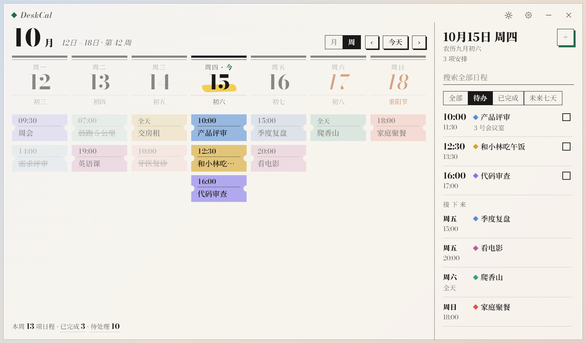
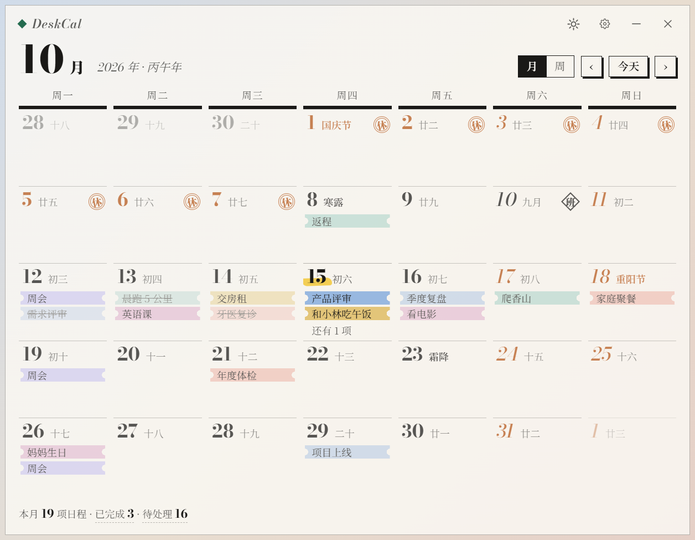
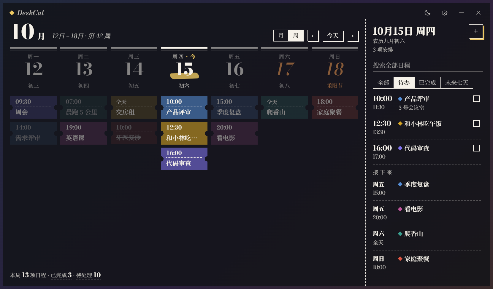
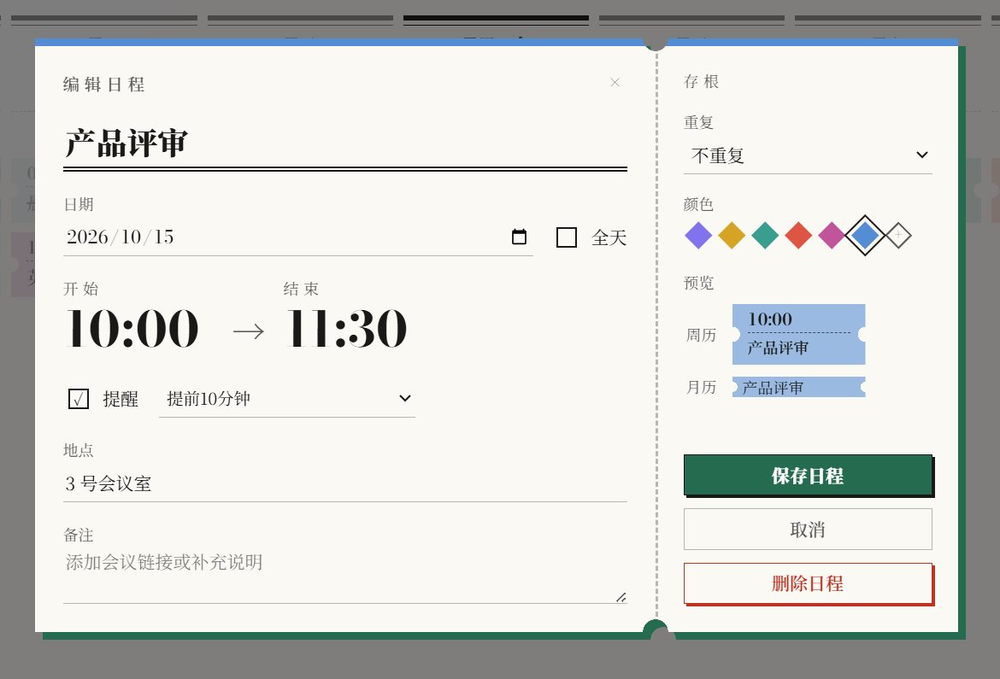

<div align="center">


# DeskCal

本地优先的 Windows 桌面日历：农历节气、法定休班、可靠提醒，常驻在桌面上。

[](https://github.com/Henry-916/DeskCal/actions/workflows/ci.yml)
[](https://github.com/Henry-916/DeskCal/releases/latest)
[](LICENSE)

[下载](https://github.com/Henry-916/DeskCal/releases/latest) · [更新日志](CHANGELOG.md) · [报告问题](https://github.com/Henry-916/DeskCal/issues)

</div>



## 功能

- **周历和月历**：周历每天一栏，日程是一张张票根；月历的格子里直接写日程标题。把日程拖到别的日期就能改期，改期和删除都能撤销。
- **中国日历**：农历（含闰月）、传统节日、二十四节气、干支纪年，以及法定放假和调休的“休”“班”角标。全部离线可用，每一项都能单独关掉。
- **提醒**：使用 Windows 系统通知。一个日程可以有多个提醒（准时、提前 5 / 10 / 30 分钟或自定义，最多提前 7 天），电脑休眠醒来后会补上错过的提醒。
- **重复日程**：每天、工作日、每周、每月、每年，或每隔 N 天 / 周 / 月 / 年；可以设截止日期或次数。修改和删除时可选本次、本次及以后或整个系列。
- **日程**：全天或起止时间、地点、备注，六种预设颜色加自定义；保存时检测时间冲突；日历底部统计本周 / 本月已完成和待处理的日程。
- **日程栏**：点日期数字展开，显示当天的农历和节假日、当天日程和接下来一周的安排，也可以搜索全部日程。
- **常驻桌面**：桌面组件模式嵌在桌面图标之上、所有窗口之下，按 `Win + D` 也看得见，不占任务栏；也可以切换成普通窗口或始终置顶。支持鼠标穿透、系统托盘和开机启动。
- **外观**：票根风格界面，内置思源宋体和 Bodoni Moda；毛玻璃或全透明背景，不透明度可调；标题栏一键切换深浅色，默认跟随系统。
- **数据在本地**：不需要账号，不上传任何数据。支持 JSON 备份导入导出，数据文件损坏时自动从备份恢复。
- **应用内更新**：从 GitHub Releases 检查、下载并安装新版本。

## 截图

| 月历 | 深色模式 |
| :---: | :---: |
|  |  |

<p align="center">
  
</p>

## 安装

1. 打开 [Releases](https://github.com/Henry-916/DeskCal/releases/latest)，下载 `DeskCal-Setup-<版本号>-x64.exe`。
2. 运行安装程序。之后有新版本时，可以在应用的设置里直接更新。

系统要求：Windows 10 / 11（64 位）。系统毛玻璃效果需要 Windows 11 22H2 及以上，其他系统可以使用透明背景。

## 使用

| 操作 | 方式 |
| --- | --- |
| 新建日程 | `Ctrl + N`，或把鼠标移到某一天，点出现的“＋” |
| 编辑日程 | 点周历里的票根或日程栏里的日程 |
| 搜索日程 | `Ctrl + F` |
| 展开 / 收起日程栏 | 点日期数字；再点一次已选中的那天，或双击窗口右边缘收起 |
| 调整宽度 | 拖窗口右边缘：日程栏展开时调日程栏，收起时调日历 |
| 切换深浅色 | 标题栏的日月按钮 |
| 隐藏到托盘 | 点关闭按钮 |
| 关闭鼠标穿透 | 托盘右键菜单 |

## 数据存放

日程保存在 Electron 的 `userData` 目录下的 `deskcal-data.json`，写入时采用原子替换，并保留 `.bak` 备份（至少间隔 10 分钟刷新一次）。

- 主数据文件损坏时，启动会自动从 `.bak` 恢复，并留存原来的损坏文件。
- 导入备份前，当前数据会先另存为 `deskcal-data.json.before-import`。
- 旧版本的数据会在启动或导入时自动迁移，原有日程不会被修改。

## 从源码运行

需要 Node.js 22 或更高版本。

```powershell
npm install
npm start
```

检查和测试：

```powershell
npm run check   # 语法检查
npm test        # 单元测试
npm run smoke   # Electron 冒烟测试
```

打包 Windows 64 位安装程序（输出到 `release/`）：

```powershell
npm run dist:win
```

### 项目结构

```text
src/
├── main.js               Electron 主进程：窗口、托盘、持久化、系统通知
├── preload.js            受限的 IPC 桥接
├── renderer/             日历界面和交互
├── calendar-core.js      日期、重复规则和提醒计算
├── chinese-calendar.js   农历、节日、节气和法定休班数据
├── planner-core.js       冲突检测、时间调整和重复系列拆分
├── data-model.js         数据版本、规范化和旧数据迁移
├── data-store.js         数据文件读写和备份恢复
├── desktop-pin.js        桌面组件模式的窗口层级（通过 koffi 调用 Windows API）
├── updater.js            应用内更新（基于 electron-updater）
└── update-source.js      更新来源仓库
tests/                    领域逻辑、迁移、渲染契约和冒烟测试
scripts/build-icon.py     从透明源图生成 PNG 和多尺寸 ICO 图标
```

## 节假日数据

农历和节气由 [lunar-javascript](https://github.com/6tail/lunar-javascript) 离线计算。

2026 年的放假和调休安排根据《国务院办公厅关于2026年部分节假日安排的通知》（国办发明电〔2025〕7号，2025 年 11 月 4 日发布）整理。调休无法用算法推出，以后的年份需要等国务院通知发布后再补充数据；在此之前，其他年份照常显示农历、节日和节气。

## 已知限制

- 目前只内置了 2026 年的法定放假和调休安排。
- 只在本机使用，还不能和 ICS、Google Calendar、Outlook 或 CalDAV 同步。

## 参与贡献

欢迎提 Issue 和 Pull Request，开始之前请先看 [CONTRIBUTING.md](CONTRIBUTING.md)。安全问题请按 [SECURITY.md](SECURITY.md) 私下报告。

## 许可证

[MIT](LICENSE)
